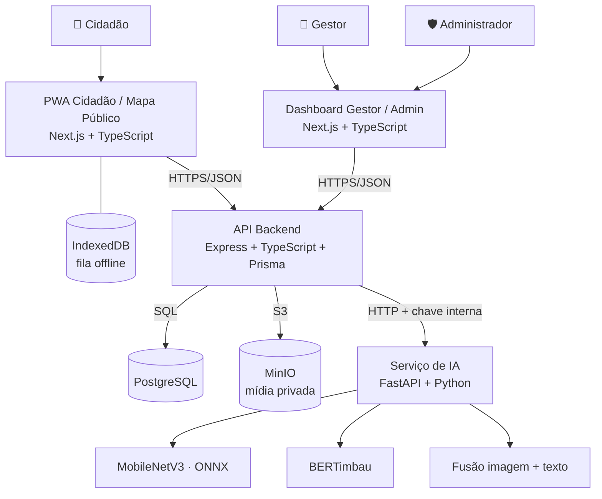

# 🌊🔥 Kamara

## **Sistema inteligente para monitoramento de desastres ambientais urbanos na Amazônia**

Plataforma que une relatos de cidadãos, Visão Computacional e Processamento de Linguagem Natural para apoiar gestores públicos na identificação, validação e acompanhamento de inundações, alagamentos e incêndios.


---

## 📌 Sobre o projeto

Cidades amazônicas enfrentam inundações, alagamentos e incêndios com frequência, muitas vezes em contextos de **baixa conectividade, infraestrutura limitada e poucos dados oficiais em tempo real**. O Kamara propõe uma forma de transformar relatos da população em informação organizada para a tomada de decisão.

O cidadão registra uma ocorrência pelo celular (com foto, descrição e localização), mesmo sem internet. O sistema faz uma **pré-análise com IA** da imagem e do texto, sugerindo a categoria do evento segundo a classificação oficial **COBRADE**. O gestor público então **valida, rejeita ou pede complementos**, acompanhando tudo em um painel com mapa e indicadores.

O Kamara é o protótipo desenvolvido a partir da pesquisa de Iniciação Científica (PIBIC 2025/2026, UFAM/ICET), cujo mapeamento sistemático foi apresentado na **IV Conferência Internacional de Políticas Públicas e Ciência de Dados (CIPPCD, Portugal, 2026)**:

> *Intelligent systems for urban environmental disaster management: a systematic mapping study with implications for Amazonian regions* — [publicação](https://bibliotecadigital.unipb.pt/entities/publication/102ca2cf-76fc-4db5-b3a3-789183491c87)

---

## ✨ Funcionalidades

### 📱 PWA do Cidadão
- Registro de ocorrências com foto, descrição e localização no mapa
- **Modo offline-first**: ocorrências ficam salvas no dispositivo (IndexedDB) e são sincronizadas quando a conexão volta, com envio idempotente
- Histórico pessoal de ocorrências e resposta a pedidos de complemento
- Mapa público de ocorrências validadas, com proteção de privacidade da localização
- Instalável como app (PWA), com tema claro e escuro

### 🖥️ Dashboard do Gestor
- Mapa e lista operacional de ocorrências
- Fila de validação humana com apoio da pré-análise de IA (imagem + texto)
- Solicitação de informações complementares ao cidadão
- Analytics com gráficos e exportação de dados
- Painel de previsão de risco (contrato arquitetural com baseline sintético, ver [Limitações](#%EF%B8%8F-limitações))

### 🛡️ Administração
- Gestão de categorias COBRADE e limiares de confiança da IA
- Convite e gestão de gestores
- Trilha de auditoria das ações

### 🔐 Segurança
- Autenticação com JWT e sessões persistentes, política de senha e redefinição por token
- Controle de acesso por papel (cidadão, gestor, administrador)
- Rate limiting, Helmet, validação de entrada com Zod e checagem de tipo real dos arquivos enviados
- Serviço de IA protegido por chave interna e mídia em bucket privado
- Registro de aceite dos termos de uso

---

## 🧠 Inteligência Artificial

O serviço de IA (FastAPI) roda separado da API principal e combina dois classificadores. Um **serviço de fusão** compara os resultados e indica se a imagem e o texto concordam, discordam ou concordam parcialmente, o que ajuda o gestor a priorizar a análise.

### Visão Computacional — `kamara_visual_mobilenet_v3_large_v1`

Classifica a foto da ocorrência em `FLOOD_WATER`, `FIRE_SMOKE` ou `OTHER`.

| Item | Detalhe |
|---|---|
| Arquitetura | MobileNetV3-Large (pré-treinada no ImageNet), fine-tuning em duas fases |
| Dados | 28.691 imagens após remoção de duplicatas exatas e quase-duplicatas (pHash) |
| Divisão | 70% treino · 15% validação · 15% teste |
| Inferência | Exportada para **ONNX** e executada com ONNX Runtime (paridade verificada com o PyTorch) |
| Incerteza | Previsões abaixo de 0,5 de confiança retornam `UNCERTAIN` |

| Métrica (teste, 4.305 imagens) | Valor |
|---|---:|
| Acurácia | 94,6% |
| Macro-F1 | 94,9% |
| F1 `FLOOD_WATER` | 97,5% |
| F1 `FIRE_SMOKE` | 93,4% |
| F1 `OTHER` | 93,8% |

### NLP — `kamara_bertimbau_v2`

Classifica a descrição textual da ocorrência em 7 categorias COBRADE (inundações, enxurradas, alagamentos e quatro tipos de incêndio), além das classes de controle `OTHER` e `INSUFFICIENT_INFO`.

| Item | Detalhe |
|---|---|
| Modelo | BERTimbau (`neuralmind/bert-base-portuguese-cased`) com fine-tuning |
| Baseline | TF-IDF + Regressão Logística |
| Dados de treino | Dataset sintético em português gerado com LLM, guiado por regras semânticas da COBRADE, plano de diversidade e curadoria |
| Avaliação honesta | Teste independente com 270 textos escritos fora do processo de geração, checagem de vazamento e teste de estresse de atalhos (*shortcut learning*) |

| Teste independente (270 textos) | BERTimbau | TF-IDF |
|---|---:|---:|
| Acurácia | **79,6%** | 58,1% |
| Macro-F1 | **76,6%** | 56,5% |

No teste sintético os dois modelos passam de 99% de acurácia, mas esse número não representa o uso real. Por isso o projeto adota o **teste independente como referência**. O BERTimbau reduziu os erros em cerca de 51% em relação ao baseline, com diferença estatisticamente significativa (teste de McNemar, p < 0,001). A principal limitação é a classe `INSUFFICIENT_INFO`. Detalhes em [`FINAL_EVALUATION.md`](ml/evaluation/nlp/independent_test_v1/FINAL_EVALUATION.md).

---

## 🏗️ Arquitetura



A **API é a autoridade do domínio**: concentra regras de negócio, transições de estado e auditoria. O serviço de IA apenas fornece inferências. As fotos ficam em armazenamento compatível com S3 (MinIO no ambiente local), separadas dos metadados no PostgreSQL.

---

## 🧰 Stack

| Camada | Tecnologias |
|---|---|
| Frontends | Next.js 14, React 18, TypeScript, Tailwind CSS, Leaflet, PWA (Service Worker + IndexedDB) |
| API | Node.js 22, Express, TypeScript, Prisma 7, Zod, JWT, Multer, AWS SDK (S3) |
| Banco e storage | PostgreSQL 16, MinIO |
| Serviço de IA | Python 3.12, FastAPI, Pydantic, ONNX Runtime, PyTorch, Hugging Face Transformers |
| ML | PyTorch, torchvision, scikit-learn, Jupyter |
| Qualidade | Vitest (testes de integração), Pytest, ESLint, Prettier |
| Infra | Docker, Docker Compose, monorepo com npm workspaces |

---

## 📂 Estrutura do repositório

```text
disaster-ai-monitoring-system/
├── apps/
│   ├── mobile/frontend/       # PWA do cidadão (Next.js)
│   ├── dashboard/frontend/    # Dashboard do gestor e admin (Next.js)
│   ├── api/backend/           # API principal (Express + Prisma)
│   └── ai-service/backend/    # Serviço de IA (FastAPI)
├── ml/
│   ├── methodology/           # Protocolos do dataset e da avaliação
│   ├── notebooks/             # Treinamento (visão e NLP)
│   ├── training/              # Scripts de treino
│   ├── evaluation/            # Métricas, matrizes de confusão, análise de erros
│   └── artifacts/             # Configuração e metadados dos modelos
├── docs/
│   ├── requisitos/            # Histórias de usuário e rastreabilidade
│   ├── modelagem/             # Casos de uso, sequência, estados, banco
│   └── arquitetura/           # C4, ADRs, fluxos de dados, sincronização offline
├── packages/shared-types/     # Tipos compartilhados
└── docker-compose.yml
```

---

## 🚀 Como executar

### Pré-requisitos
- [Docker](https://docs.docker.com/get-docker/) e Docker Compose
- Node.js 22+ e Python 3.12+ (apenas para desenvolvimento fora do Docker)

### 1. Clone o repositório

```bash
git clone https://github.com/gregoryozaki/disaster-ai-monitoring-system.git
cd disaster-ai-monitoring-system
```

### 2. Configure as variáveis de ambiente

```bash
cp .env.example .env
cp apps/api/backend/.env.example apps/api/backend/.env
```

Antes de qualquer uso fora do ambiente local, troque `JWT_SECRET`, `AI_SERVICE_API_KEY` e as senhas do banco e do MinIO.

### 3. Adicione os pesos dos modelos

Os arquivos de pesos não são versionados por causa do tamanho. Coloque-os nas pastas:

```text
ml/artifacts/computer-vision/kamara_visual_mobilenet_v3_large_v1/kamara_visual_mobilenet_v3_large_v1.onnx
ml/artifacts/nlp/kamara_bertimbau_v2/model.safetensors
```

Eles podem ser gerados pelos notebooks em `ml/notebooks/`.

### 4. Suba o sistema

```bash
docker compose up --build
```

As migrações do banco são aplicadas automaticamente quando a API inicia.

| Serviço | Endereço |
|---|---|
| PWA do cidadão | http://localhost:3001 |
| Dashboard do gestor | http://localhost:3002 |
| API | http://localhost:3333 |
| Serviço de IA | http://localhost:8000 |
| Console do MinIO | http://localhost:9001 |

### 5. Popule as categorias e crie o administrador

```bash
docker compose exec api npx prisma db seed

docker compose exec \
  -e KAMARA_ADMIN_EMAIL=admin@exemplo.com \
  -e KAMARA_ADMIN_PASSWORD='SuaSenhaForte@123' \
  api npm run bootstrap:admin
```

### Desenvolvimento local (sem Docker para as aplicações)

```bash
docker compose up -d postgres minio ai-service
npm install
npm run dev:api        # API em :3333
npm run dev:mobile     # PWA em :3001
npm run dev:dashboard  # Dashboard em :3002
```

---

## 🧪 Testes

```bash
# API: typecheck, lint e formatação
npm run check:api

# API: testes de integração (usa um banco cujo nome contenha "kamara_test")
npm --workspace @kamara/api run test

# Serviço de IA
cd apps/ai-service/backend
pip install -r requirements-dev.txt
pytest
```

A API tem testes de integração para autenticação, ocorrências, sincronização offline, validação, mídia, analytics, exportações, rate limiting e integração com o serviço de IA.

---

## 📚 Documentação

O projeto foi construído com documentação de engenharia de software desde o início:

- **Requisitos:** histórias de usuário e matriz de rastreabilidade ([`docs/requisitos`](docs/requisitos))
- **Modelagem:** casos de uso, diagramas de sequência, atividades, estados, MoLIC e modelo de dados ([`docs/modelagem`](docs/modelagem))
- **Arquitetura:** modelo C4, topologia de execução e fluxos de dados ([`docs/arquitetura`](docs/arquitetura))
- **Decisões de arquitetura (ADRs):** stack, IA desacoplada, PostgreSQL, offline com IndexedDB, *human-in-the-loop*, privacidade do mapa público, storage de mídia e versionamento de modelos ([`decisoes`](docs/arquitetura/Kamara_Arquitetura_Complementar/decisoes))
- **Metodologia de ML:** definição da tarefa, regras semânticas COBRADE e protocolo de avaliação independente ([`ml/methodology`](ml/methodology))

---

## ⚠️ Limitações

O Kamara é um **protótipo acadêmico** e não deve ser usado como sistema oficial de alerta sem validação adicional.

- **Previsão de risco:** o endpoint atual usa um baseline sintético que apenas demonstra o contrato da API. Ainda não usa dados meteorológicos, hidrológicos ou históricos reais.
- **Explicabilidade (XAI):** as explicações exibidas são textuais e simplificadas. Técnicas como Grad-CAM e SHAP estão previstas, mas não implementadas.
- **NLP:** treinado com dados sintéticos. Teve bom desempenho no teste independente, mas ainda precisa ser avaliado com relatos reais da população amazônica, e tem dificuldade em reconhecer textos sem informação suficiente.
- **Visão Computacional:** treinada com bases públicas, que podem não refletir as condições visuais típicas das cidades amazônicas.

---

## 👥 Autoria

Desenvolvido por **[Gregory Ozaki](https://github.com/gregoryozaki)** como parte da Iniciação Científica no Instituto de Ciências Exatas e Tecnologia da Universidade Federal do Amazonas (ICET/UFAM), em Itacoatiara-AM, sob orientação do **Dr. Rainer Amorim** e da colaboração da discente **Ana Paula Guimarães Xavier** e do **Dr. Hidelbrando Rodrigues**.

Vinculado ao Laboratório de Otimização, Gestão e Análise e Robótica (LOGAR) e ao Núcleo de Pesquisa em Ciência de Dados e Otimização (NuPeC).

---

## 📄 Licença

Distribuído sob a licença MIT. Veja [`LICENSE`](LICENSE) para mais informações.

<div align="center">

🌳 *Ciência feita a partir do interior do Amazonas, para o Amazonas.*

</div>
